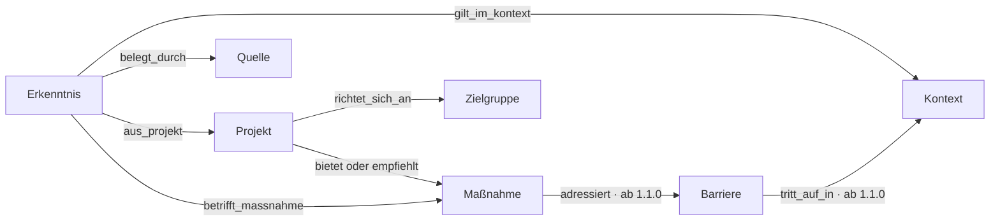

# Ontologie des Knowledge Garden

**Fachlicher Stand: ungeprüft.** Die Demo verwendet zuerst `1.0.0`. Nach einer simulierten Modellentscheidung verwendet sie `1.1.0`.

Eine neue Quelle ergänzt meistens die Wissensbasis. Sie verändert das Modell nur, wenn ein fehlender Typ oder eine fehlende Beziehung eine wichtige Frage verhindert.

## Geltungsbereich

Projektwissen zur digitalen Teilhabe älterer Menschen. Im Mittelpunkt stehen kontextgebundene Erkenntnisse. Ein Ergebnis aus einer Befragung wird nicht zu einer Regel für alle Projekte.

Die maschinenlesbaren Definitionen stehen in `ontologie/1.0.0.json` und `ontologie/1.1.0.json`. Diese Dateien sind die verbindliche Grundlage der technischen Prüfung.

## Typen

| Typ                   | Bedeutung                                        | Beispiel                                   |
| --------------------- | ------------------------------------------------ | ------------------------------------------ |
| `Projekt`             | Benanntes Vorhaben                               | DigitalPakt Alter                          |
| `Massnahme`           | Beschriebenes Vorgehen                           | Individuelle Lernbegleitung                |
| `Zielgruppe`          | Adressierte Personengruppe                       | Ältere Menschen                            |
| `Kontext`             | Bedingung zur Einordnung                         | Dauerhafter Unterstützungsbedarf           |
| `Erkenntnis`          | Belegte Aussage mit Interpretation und Grenzen   | Einstieg braucht weitere Unterstützung     |
| `Quelle`              | Gesichertes Original mit Herkunft                | Evaluation von 2022                        |
| `Barriere` · ab 1.1.0 | Konkretes Hindernis beim Zugang zu einem Angebot | Rein visuelle Inhalte sind nicht erkennbar |

Die Barriere beschreibt das Zusammenspiel von Angebot und Bedarf. Eine Personengruppe ist keine Barriere.

## Beziehungen

| Beziehung                 | Ausgangspunkt → Ziel    | Bedeutung                                                                                                        |
| ------------------------- | ----------------------- | ---------------------------------------------------------------------------------------------------------------- |
| `bietet`                  | Projekt → Maßnahme      | Das Projekt bietet die Maßnahme an.                                                                              |
| `empfiehlt`               | Projekt → Maßnahme      | Ein Projektdokument empfiehlt die Maßnahme. Umsetzung bleibt offen.                                              |
| `richtet_sich_an`         | Projekt → Zielgruppe    | Das Angebot adressiert die Gruppe.                                                                               |
| `aus_projekt`             | Erkenntnis → Projekt    | Die Aussage stammt aus diesem Projektkontext.                                                                    |
| `betrifft_massnahme`      | Erkenntnis → Maßnahme   | Die Aussage ordnet das Vorgehen ein.                                                                             |
| `gilt_im_kontext`         | Erkenntnis → Kontext    | Die Bedingung begrenzt die Einordnung.                                                                           |
| `widerspricht`            | Erkenntnis → Erkenntnis | Aussagen schließen sich bei vergleichbaren Bedingungen aus.                                                      |
| `praezisiert`             | Erkenntnis → Erkenntnis | Eine Erkenntnis ergänzt Bedingungen einer anderen Erkenntnis. Die Zuordnung ist als KI-Interpretation erkennbar. |
| `belegt_durch`            | Fachentität → Quelle    | Die Quelle stützt die Aussage.                                                                                   |
| `adressiert` · ab 1.1.0   | Maßnahme → Barriere     | Die Maßnahme soll das Hindernis verringern. Eine gemessene Wirkung wird nicht behauptet.                         |
| `tritt_auf_in` · ab 1.1.0 | Barriere → Kontext      | Das Hindernis ist für diesen Kontext beschrieben.                                                                |

## Warum wird das Modell erweitert?

Q03 passt in das Startmodell. Das Dokument fügt ein Projekt, Erkenntnisse und Belege hinzu. Die Maßnahme „Individuelle Lernbegleitung“ bleibt dieselbe Entität.

Q04 beschreibt konkrete Anpassungen für Videokonferenzen. Mit dem Startmodell lässt sich darüber schreiben. Die neue Frage [[COMPETENCY-QUESTIONS#KF06|KF06]] verlangt aber eine strukturierte Zuordnung von Maßnahme zu Barriere. Ein Kontext allein liefert diese Zuordnung nicht.

Das ist eine bewusste Modellierungsentscheidung. Eine andere zulässige Lösung wäre eine besondere Kontextbeziehung. Die Demo wählt einen eigenen Typ, damit Barrieren über mehrere Maßnahmen hinweg auffindbar bleiben. [[ontologie/AENDERUNG-001|Änderungsvorschlag und Alternativen]].

## Pflichtregeln

- Jede Fachentität hat eine Kennung, einen Typ, einen Titel, einen Kurztext, einen Prüfstatus und Belege.
- Jede Erkenntnis nennt Beobachtung, Interpretation, Übertragbarkeit, Evidenzgrenzen und eine offene Frage.
- Jede Erkenntnis verweist auf mindestens ein Projekt, eine Maßnahme und einen Kontext.
- Beziehungen haben nur die definierten Ausgangs- und Zieltypen.
- Ein neues Dokument überschreibt keine bestehende Erkenntnis.
- Eine Modelländerung ist von einer Fachprüfung der Aussagen getrennt.

[[SCHEMA|Arbeitsregeln]] · [[METHODIK|Methodischer Ablauf]] · [[demo/ONTOLOGIE.diff|Technischer Modellunterschied]]
